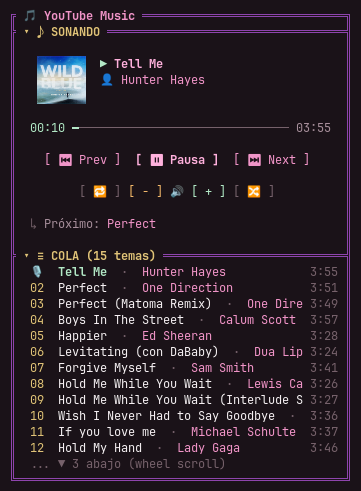

# pi-youtube-player 🎵

> Extensión modular ultra-liviana para el arnés de agentes **Pi** (`@earendil-works/pi-coding-agent`) que permite controlar tu sesión nativa de **YouTube Music** (con tu cuenta **Premium**, cero anuncios y máxima fidelidad de audio) directamente desde la terminal y la sidebar interactiva, sin consumir memoria extra y con total aislamiento de medios.

<p align="center">
  
</p>

---

## 🎯 Visión y Filosofía

1. **YouTube Music Premium Nativo:** No utiliza librerías de scraping ni APIs externas no oficiales. Se enlaza de forma segura con la pestaña que ya tenés abierta en tu navegador con tu sesión iniciada.
2. **Cero Consumo Adicional de Recursos:** No levanta navegadores headless ni instancias de Electron extra. La extensión se comunica mediante un WebSocket local minúsculo (<1 MB RAM, 0% CPU).
3. **Aislamiento Estricto de Medios:** A diferencia del protocolo genérico D-Bus/MPRIS de Linux (que mezcla Spotify, Netflix, Discord o llamadas), este reproductor se conecta **única y exclusivamente** con tu pestaña de YouTube Music.
4. **Desacoplado y Extensible:** La lógica vive en esta extensión independiente. Expone su estado y API a través de un `Symbol` global canónico (`Symbol.for('pi-youtube-player')`), lo que permite que cualquier tema (como `pi-cinlodev-cute`) o componente TUI dibuje controles interactivos y gestione clics del mouse sin acoplamiento.

---

## ✨ Características Principales

- **🎮 Controles Completos:** Play, Pausa, Siguiente tema, Tema anterior y control fino de Volumen (`/yt vol <0-100>`, `+10`, `-10`).
- **⏱️ Telemetría en Tiempo Real:** Barra de progreso dinámica que avanza segundo a segundo con el tiempo real de la pista actual.
- **📜 Cola Dinámica (Up Next) Clickeable:** Ventana deslizante que detecta cuál es la canción que está sonando y lista los próximos temas. Hacé clic con el mouse en cualquier canción de la lista para que empiece a sonar inmediatamente.
- **🛡️ Arquitectura Segura Manifest V3:** El WebSocket corre dentro de un Service Worker de fondo (`background.js`) para evitar bloqueos de *Mixed Content* en páginas HTTPS.
- **⚡ Reconexión Silenciosa:** Si cerrás o recargás Pi o el navegador, la conexión se restablece sola en milisegundos sin tirar errores.

---

## 🏗️ Arquitectura General

```
┌────────────────────────────────────────┐
│      Google Chrome (Manifest V3)       │
│  Pestaña: music.youtube.com (Premium)  │
│  └─ Content Script (Lectura del DOM)   │
│         │ chrome.runtime               │
│  └─ Background Service Worker          │
└───────────────────▲────────────────────┘
                    │ WebSocket Local
                    │ ws://127.0.0.1:7788
┌───────────────────▼────────────────────┐
│  pi-youtube-player (Extensión de Pi)   │
│  - Servidor WebSocket local            │
│  - Gestor de estado reactivo           │
│  - Comandos Slash (/yt, /yt vol, etc.) │
│  - API pública via Symbol global       │
└───────────────────▲────────────────────┘
                    │ Symbol.for('pi-youtube-player')
┌───────────────────▼────────────────────┐
│  Sidebar TUI (ej. pi-cinlodev-cute)    │
│  - Tab dedicado [ 6:YT ]               │
│  - [⏮ Prev] [ ▶ Play ] [⏭ Next]        │
│  - Lista Up Next con clic interactivo  │
└────────────────────────────────────────┘
```

---

## 🚀 Instalación y Puesta en Marcha

### 1. Cargar la Mini Extensión en Chrome
1. Abrí Google Chrome y navegá a `chrome://extensions/`.
2. Activá el interruptor **"Modo de desarrollador"** (arriba a la derecha).
3. Hacé clic en **"Cargar descomprimida" (Load unpacked)**.
4. Seleccioná la carpeta `extension/` clonada en tu máquina local:
   ```bash
   path/to/pi-youtube-player/extension
   ```
5. Abrí `https://music.youtube.com/`, poné play a cualquier canción o playlist y abrí el panel "A continuación".

### 2. Habilitar la Extensión en Pi
Creá o agregá el loader en tu directorio de extensiones de Pi (`~/.pi/agent/extensions/pi-youtube-player.ts`):
```typescript
import activate from '<ruta-al-proyecto>/dist/index.js';
export default activate;
```

---

## ⌨️ Comandos Slash en Pi

| Comando | Acción |
|---|---|
| `/yt` o `/yt play` | Alterna entre reproducir y pausar |
| `/yt next` | Salta a la siguiente canción |
| `/yt prev` | Vuelve a la canción anterior |
| `/yt vol <0-100>` | Ajusta el volumen al porcentaje exacto |
| `/yt vol +10` / `/yt vol -10` | Sube o baja el volumen de a 10% |
| `/yt mute` | Alterna el mute de audio |
| `/yt status` | Muestra un resumen de una sola línea de lo que está sonando |
| `/yt queue` | Lista los próximos 10 temas en espera |
| `/yt <número>` | Salta directo a reproducir ese número de la cola |

---

## 📚 Documentación Técnica Adicional

- [Arquitectura y Protocolo de Comunicación (ARCHITECTURE.md)](./ARCHITECTURE.md)
- [Roadmap de Implementación (ROADMAP.md)](./ROADMAP.md)

---

## 📄 Licencia

MIT © CinloDev
