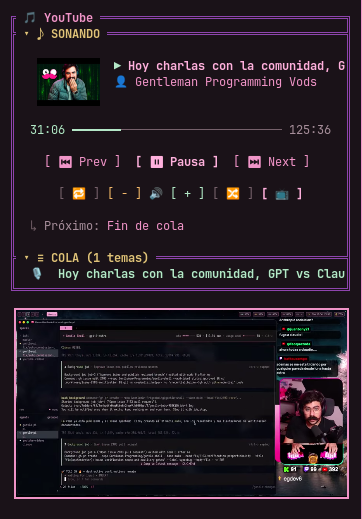

# pi-youtube-player 🎵

> Extensión modular ultra-liviana para el arnés de agentes **Pi** (`@earendil-works/pi-coding-agent`) que permite controlar tu sesión nativa de **YouTube Music** y **YouTube tradicional** (con tu cuenta **Premium**, cero anuncios y máxima fidelidad de audio/video) directamente desde la terminal y la sidebar interactiva, sin consumir memoria extra y con total aislamiento de medios.

<p align="center">
  
  
</p>

---

## 🎯 Visión y Filosofía

1. **Soporte Universal YouTube & YouTube Music:** No utiliza librerías de scraping ni APIs externas no oficiales. Se enlaza de forma segura y transparente con la pestaña que tengas abierta en tu navegador (`music.youtube.com` o `www.youtube.com`), adaptándose dinámicamente según la plataforma.
2. **Cero Consumo Adicional de Recursos:** No levanta navegadores headless ni instancias de Electron extra. La extensión se comunica mediante un WebSocket local minúsculo (<1 MB RAM, 0% CPU).
3. **Aislamiento Estricto de Medios:** A diferencia del protocolo genérico D-Bus/MPRIS de Linux (que mezcla Spotify, Netflix, Discord o llamadas), este reproductor se conecta **única y exclusivamente** con tu pestaña activa de YouTube.
4. **Desacoplado y Extensible:** La lógica vive en esta extensión independiente. Expone su estado y API a través de un `Symbol` global canónico (`Symbol.for('pi-youtube-player')`), lo que permite que cualquier tema (como `pi-cinlodev-cute`) o componente TUI dibuje controles interactivos y gestione clics del mouse sin acoplamiento.

---

## ✨ Características Principales

- **🌐 Soporte Dual Transparente:** Cambiá entre escuchar música en YouTube Music y ver un podcast o tutorial en YouTube tradicional; el reproductor detecta la pestaña activa automáticamente y mapea sus controles.
- **🎮 Controles Completos:** Play, Pausa, Siguiente tema/video, Anterior y control fino de Volumen con botones táctiles y anchos (`[ - ]` y `[ + ]`), sincronizados con la barra nativa y el reproductor de YouTube.
- **🔁 Modos de Repetición y Aleatorio:** Botones interactivos en la sidebar con soporte para Bucle cíclico (`[ 🔁 ]` para lista completa, `[ 🔂 ]` para un solo tema) y Aleatorio / Shuffle (`[ 🔀 ]`), conmutables con un clic de mouse o vía comandos de terminal.
- **📺 Ventana Flotante de Video (Picture-in-Picture Nativo):** Botón interactivo `[ 📺 ]` y comando `/yt pip` que abren o cierran al instante la ventana flotante nativa de video en vivo (con cambio inteligente de canción a video en Music y PiP directo en YouTube tradicional).
- **⏱️ Telemetría en Tiempo Real:** Barra de progreso dinámica que avanza segundo a segundo con el tiempo real de la pista actual.
- **📜 Cola Dinámica (Up Next / Playlist) Clickeable:** Ventana deslizante que detecta la canción o video que está sonando y lista los próximos 15 elementos (de la cola de Music, de una Playlist o de los recomendados de YouTube). Hacé clic con el mouse en cualquier elemento para reproducirlo al instante.
- **🔍 Búsqueda y Favoritos Directos:** Buscá y reproducí temas, videos o canales (`/yt search <query>`) y cargá tu playlist de canciones que te gustan (`/yt likes`) al instante.
- **🧹 Gestión de Cola:** Vaciá la lista (`/yt clear`) o eliminá canciones específicas (`/yt remove <#n>`).
- **🛡️ Arquitectura Segura Manifest V3 y Bypass de CSP:** El Service Worker (`background.js`) maneja el WebSocket local, mientras que un script dedicado en el `MAIN` world (`main-world.js`) interactúa de forma nativa con los controladores y stores internos sin ser bloqueado por la Content Security Policy de Google.
- **🔄 Daemon Centralizado Multi-Terminal:** Un servicio de fondo desacoplado (`daemon.js` / systemd) administra la conexión exclusiva con Chrome y retransmite a múltiples terminales de Pi en simultáneo sin conflictos de puertos.
- **⚡ Reconexión Silenciosa:** Si cerrás o recargás Pi o el navegador, la conexión se restablece sola en milisegundos sin tirar errores.

---

## 🏗️ Arquitectura General

```
┌────────────────────────────────────────────────────────┐
│              Google Chrome (Manifest V3)               │
│     music.youtube.com (Music) / youtube.com (Video)    │
│                                                        │
│  ┌─ MAIN World (main-world.js) ─────────────────────┐  │
│  │  ytmusic-player-bar & movie_player API direct     │  │
│  └───────────────────▲──────────────────────────────┘  │
│                      │ window.postMessage              │
│  ┌─ ISOLATED World (content-script.js) ─────────────┐  │
│  │  MusicAdapter / StandardAdapter (Detección DOM)  │  │
│  └───────────────────▲──────────────────────────────┘  │
│                      │ chrome.runtime                  │
│  ┌─ Background Service Worker (background.js) ──────┐  │
│  │  Mantiene socket sin bloqueo de Mixed Content    │  │
│  └───────────────────▲──────────────────────────────┘  │
└──────────────────────┼─────────────────────────────────┘
                       │ WebSocket Local
                       │ ws://127.0.0.1:7788
┌──────────────────────▼─────────────────────────────────┐
│              pi-youtube-daemon (Systemd)               │
│  - Servidor WebSocket centralizado                     │
│  - Descarga y caché de carátulas en /tmp               │
│  - Retención de estado reactivo y broadcast            │
└──────────▲─────────────────────────────────▲───────────┘
           │ ws://127.0.0.1:7788             │ ws://127.0.0.1:7788
┌──────────▼───────────────┐     ┌───────────▼───────────────┐
│   Pi Terminal 1 (pid A)  │     │   Pi Terminal 2 (pid B)   │
│   - Cliente WS ligero    │     │   - Cliente WS ligero     │
│   - Comandos Slash /yt   │     │   - Comandos Slash /yt    │
│   - Sidebar TUI [ 6:YT ] │     │   - Sidebar TUI [ 6:YT ]  │
└──────────────────────────┘     └───────────────────────────┘
```

---

## 🚀 Instalación y Puesta en Marcha

### 1. Cargar la Mini Extensión en Chrome
1. Abrí Google Chrome y navegá a `chrome://extensions/`.
2. Activá el interruptor **"Modo de desarrollador"** (arriba a la derecha).
3. Hacé clic en **"Cargar descomprimida" (Load unpacked)**.
4. Seleccioná la carpeta `extension/` clonada en tu máquina local:
   ```bash
   path/to/pi-youtube-player/extension
   ```
5. Abrí `https://music.youtube.com/` o `https://www.youtube.com/`, poné play a cualquier canción o video y el reproductor se sincronizará automáticamente.

### 2. Iniciar el Daemon de Fondo (Systemd Service)
Para que todas las terminales de Pi compartan la música en simultáneo sin bloquear puertos:
```bash
# Compilar el proyecto
pnpm run build

# Iniciar el daemon como servicio de usuario
mkdir -p ~/.config/systemd/user
cp pi-youtube-daemon.service ~/.config/systemd/user/
systemctl --user daemon-reload
systemctl --user enable --now pi-youtube-daemon
```

### 3. Habilitar la Extensión en Pi
Creá o agregá el loader en tu directorio de extensiones de Pi (`~/.pi/agent/extensions/pi-youtube-player.ts`):
```typescript
import activate from '<ruta-al-proyecto>/dist/index.js';
export default activate;
```

---

## ⌨️ Comandos Slash en Pi

| Comando | Acción |
|---|---|
| `/yt` o `/yt play` | Alterna entre reproducir y pausar |
| `/yt next` o `/yt skip` | Salta a la siguiente canción |
| `/yt prev` o `/yt back` | Vuelve a la canción anterior |
| `/yt repeat` o `/yt loop` | Cicla modo bucle: desactivado ➡️ toda la lista (`🔁`) ➡️ canción actual (`🔂`) |
| `/yt shuffle` o `/yt random` | Alterna modo aleatorio (`🔀`) |
| `/yt pip` o `/yt video` | Abre o cierra la ventana flotante nativa de video (Picture-in-Picture) |
| `/yt vol <0-100>` | Ajusta el volumen al porcentaje exacto |
| `/yt vol +10` / `/yt vol -10` | Sube o baja el volumen en saltos de 10% |
| `/yt mute` | Alterna el mute de audio |
| `/yt search <query>` | Busca y reproduce inmediatamente un tema o artista |
| `/yt likes` | Carga y reproduce tu lista de "Canciones que te gustan" |
| `/yt queue` | Lista los próximos 15 temas en espera |
| `/yt <número>` | Salta directo a reproducir ese número de la cola |
| `/yt remove <#n>` | Quita la canción indicada de la cola de reproducción |
| `/yt clear` | Vacía la cola de reproducción |
| `/yt status` | Muestra un resumen de una sola línea de lo que está sonando |

---

## 📚 Documentación Técnica Adicional

- [Arquitectura y Protocolo de Comunicación (ARCHITECTURE.md)](./ARCHITECTURE.md)
- [Roadmap de Implementación (ROADMAP.md)](./ROADMAP.md)

---

## 📄 Licencia

MIT © CinloDev
